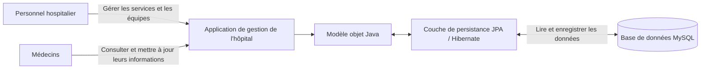
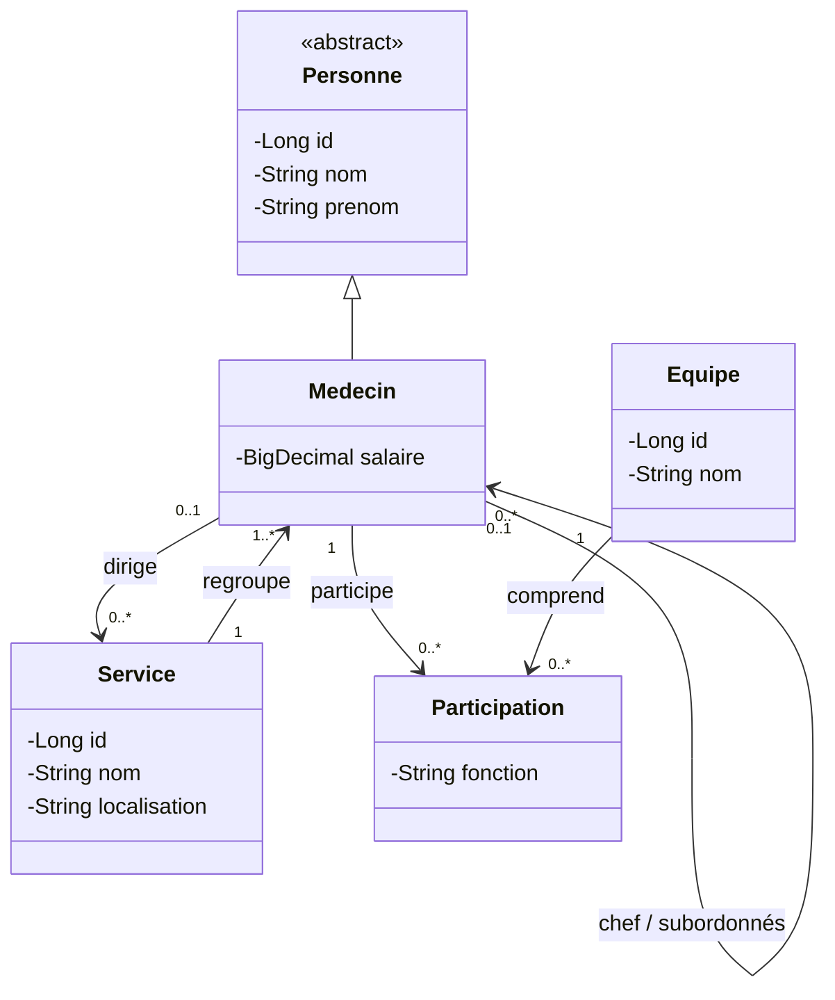

# Conception de l'application Hôpital

## Question 1 : schéma synoptique



L'application centralise les informations des services, des médecins et des équipes. JPA assure le mapping entre le modèle objet Java et les tables MySQL; les utilisateurs interagissent avec l'application plutôt qu'avec la base directement.

## Question 2 : diagramme de classes



Une participation représente le lien entre un médecin et une équipe; son attribut `fonction` indique son rôle dans l'équipe. Le diagramme décrit le domaine global du TP. L'implémentation de l'héritage et des associations entre médecins et services sera réalisée dans les questions ultérieures.

## Questions 3 à 5 : prérequis du projet

- Question 3 : créer la base MySQL avant le test. La commande attendue est `CREATE DATABASE hopital;`.
- Question 4 : les sources sont dans `src/main/java`, les ressources dans `src/main/resources` et la configuration VS Code référence ces deux chemins.
- Question 5 : le pilote MySQL et les dépendances Hibernate/JPA sont présents dans `lib/`.

## Question 6 : paramètres de connexion

L'URL et le pilote JDBC restent configurés dans `persistence.xml`. Les identifiants sont fournis au lancement par `HOPITAL_DB_USER` (par défaut `root`) et `HOPITAL_DB_PASSWORD`, afin de ne pas conserver de mot de passe dans le dépôt. La base `hopital` doit exister avant de lancer `Test1`.

Dans un terminal zsh ouvert à la racine du projet, définir le mot de passe uniquement pour la session courante :

```sh
export HOPITAL_DB_USER=root
read -s HOPITAL_DB_PASSWORD
export HOPITAL_DB_PASSWORD
BUILD_DIR="$(mktemp -d)"
javac -encoding UTF-8 -cp 'lib/*' -d "$BUILD_DIR" $(find src/main/java -name '*.java' -print)
cp -R src/main/resources/. "$BUILD_DIR"/
java -cp "$BUILD_DIR:lib/*" tests.Test1
```

## Questions 7 et 8 : état de l'implémentation

`Service` mappe la clé générée sur `SERVNO`, impose un nom unique et des champs non nuls de 42 caractères maximum. Le nom et la localisation sont normalisés en majuscules; l'égalité repose sur le nom naturel, et non sur la clé générée.

`Test1` persiste deux services dans une transaction puis modifie la localisation du premier avant le commit. Après exécution, la base doit contenir deux lignes; la localisation de `CARDIOLOGIE` doit être `BAT D, 2ÈME ÉTAGE`. Le service simplement construit mais jamais passé à `persist` n'est pas nécessaire au test.